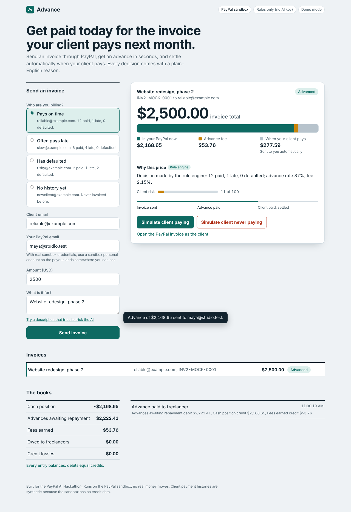

# Advance

**Get paid today for the invoice your client pays next month.**

Advance is instant invoice financing for freelancers and small sellers, built on the
PayPal sandbox (Invoicing, Payouts, Webhooks) with a Claude underwriting review. It is a
single Go binary with no third-party Go dependencies.



## How it works

1. A freelancer's invoice is sent to their client through the **PayPal Invoicing API**.
2. The freelancer asks for an advance. A deterministic **rule engine** prices the risk
   from the client's payment history (advance rate 72-90% of the invoice, risk-based fee; unknown clients are declined).
3. **Claude reviews** the case: invoice description, parties, history, rule output. It
   returns a plain-English explanation and red flags, and can only **tighten** the offer
   (approve, reduce or decline). It never sets an amount, so a prompt-injected invoice
   description cannot raise a payout.
4. If approved, the advance is paid instantly with **PayPal Payouts**.
5. When the client pays, PayPal's **`INVOICING.INVOICE.PAID` webhook** (signature-verified)
   settles the advance in a **double-entry ledger** and pays the freelancer the remainder.
   A cancelled or long-overdue invoice is written off as a credit loss and lowers that
   client's score for future advances.

## Quick start (no credentials, 1 minute)

Requires Go 1.22 or newer.

```sh
make demo          # starts Advance + a local PayPal mock, then open http://localhost:8080
```

In the dashboard: pick a client profile, create an invoice, click **Get advance**, then
**Simulate client paying** to watch settlement. Try `risky@example.com` to see a decline.
Set `ANTHROPIC_API_KEY` first to get Claude's review instead of the rules-only explanation.

## Run against the real PayPal sandbox

See [`NEXT_STEPS.md`](NEXT_STEPS.md) for the full walkthrough. In short:

```sh
cp .env.example .env     # add sandbox client ID/secret, webhook ID, optional Anthropic key
make run
```

## API

| Method | Path | Purpose |
| --- | --- | --- |
| `POST` | `/invoices` | Create and send a PayPal invoice |
| `GET` | `/invoices`, `/invoices/{id}` | List or fetch invoices |
| `POST` | `/invoices/{id}/advance` | Underwrite and pay an advance |
| `GET` | `/ledger` | Balances and every journal entry; `balanced` must be `true` |
| `POST` | `/webhooks/paypal` | PayPal webhook receiver (signature verified) |
| `POST` | `/demo/invoices/{id}/pay`, `/default` | Demo mode only: simulate the client paying or defaulting |
| `GET` | `/healthz`, `/meta` | Health check and UI metadata |

Spec: [`docs/openapi.yaml`](docs/openapi.yaml). Postman: [`docs/postman_collection.json`](docs/postman_collection.json)
(set `baseUrl`, and `apiKey` if you set `API_KEY`).

## Design choices that matter for money

- **Idempotent everywhere.** Payout requests carry a deterministic `PayPal-Request-Id`,
  ledger entries are keyed, and webhook event IDs are de-duplicated, so retries cannot pay twice.
- **AI can only tighten.** Claude's output is clamped to a verdict and a 0-1 multiplier.
  If the model is unreachable, Advance falls back to the rules and says so.
- **Exposure caps.** Per-invoice and total outstanding limits are reserved under a lock, so
  concurrent requests cannot exceed them.
- **Integer cents** throughout. Every ledger entry must sum to zero.
- **Webhooks are verified** with PayPal's `verify-webhook-signature` API. In demo mode, the
  `/demo/*` endpoints exist only when `DEMO_MODE=true`.
- Optional API key, per-IP rate limiting, security headers, panic recovery, graceful shutdown.

More detail in [`ARCHITECTURE.md`](ARCHITECTURE.md).

## Honest limits

- The PayPal sandbox has no real credit data, so client payment histories are **synthetic**
  (`reliable@`, `slow@`, `risky@example.com`, or your own sandbox buyers via `DEMO_CLIENTS`).
- State lives in memory with an optional JSON snapshot (`DATA_FILE`), which is right for a
  demo; production would use Postgres.
- Sandbox only. Operating a real lending product needs licensing, compliance and KYC that
  this project does not attempt.

## Develop

```sh
make test      # unit + HTTP + end-to-end tests; no network needed
make race      # same, with the race detector
make vet fmt
```

Layout: `cmd/advance` (server), `cmd/mockpaypal` (offline PayPal mock), `internal/paypal`
(REST client), `internal/ledger`, `internal/underwriting`, `internal/ai` (Claude review),
`internal/api` (HTTP, webhooks, defaults), `internal/web` (embedded dashboard).

## Deploy

`render.yaml` is a Render Blueprint (Docker). Details in `NEXT_STEPS.md`.

## License

MIT, see [`LICENSE`](LICENSE).
